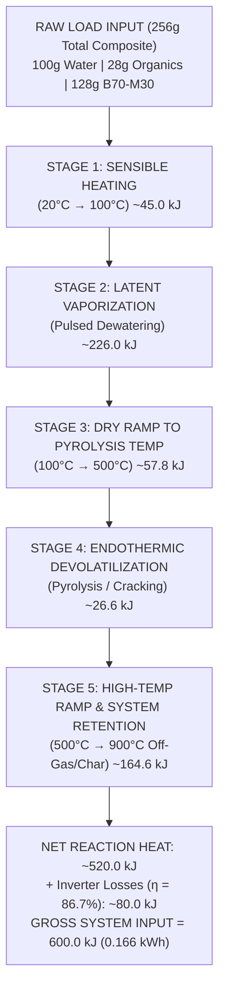
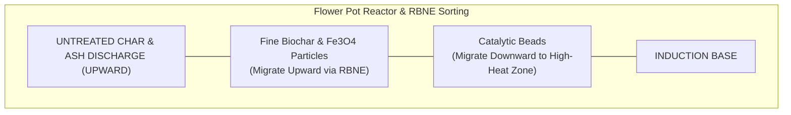
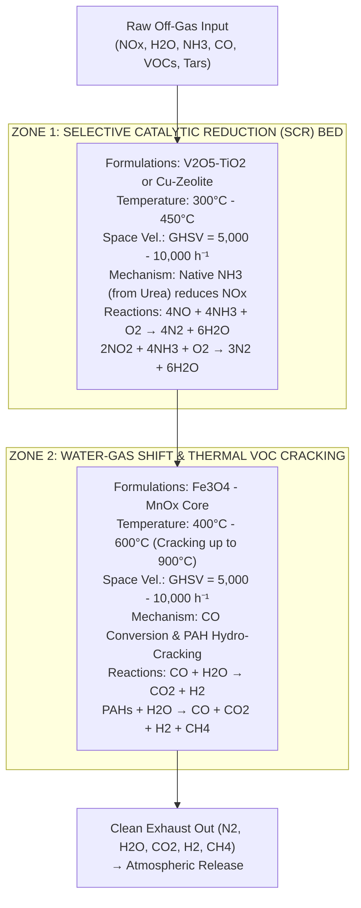

# Design and Thermodynamic Analysis of an Off-Grid Non-Sewered Sanitation System: Induction Pyrolysis, Pulsed Dewatering, and Off-Gas Scrubbing

**Lead Author:** Lawrence Reed Kincheloe III
**Affiliations:** Public Invention
**Acknowledgements:** Material and logistics support provided by the Idea Forge Foundation

---

## Abstract

The global deployment of off-grid Non-Sewered Sanitation Systems (NSSS) relies fundamentally on optimizing thermal energy utilization. In unsewered regions, managing human fecal sludge requires processing high-moisture organic waste without access to grid electricity or continuous municipal water supplies. This paper presents the design and thermodynamic modeling of an autonomous off-grid sanitation platform integrating direct volumetric induction heating using an engineered composite carrier susceptor matrix (B70-M30: 70% sodium bentonite clay / kitty litter base and 30% magnetite $\text{Fe}_3\text{O}_4$ powder), which directly encapsulates and couples electromagnetic energy into the wet fecal and urine mass. Coupled with high-frequency pulsed steam dewatering with dynamic algorithmic dryness detection ($D_p$), passive particle-sorting reactor geometry via the Reverse Brazil Nut Effect (RBNE), and a multi-phase catalytic scrubbing matrix (SCR and Water-Gas Shift/VOC cracking), the system reduces total process energy consumption to approximately $600\text{ kJ}$ ($0.166\text{ kWh}$) per nominal $128\text{ g}$ fecal load, guarantees 6-log ($99.9999\%$) pathogen destruction via supersonic steam flashing, and complies with ISO 30500 and EPA CAA Section 129 regulatory frameworks.

---

## 1. Initial Coupling Matrix, Carrier Dosing, & System Architecture

### 1.1 Composite Absorbent & Magnetic Susceptor Matrix (B70-M30)

The primary waste reception interface utilizes an engineered composite carrier matrix designated as B70-M30. This material is formulated as a homogenized dry mixture consisting of 70% high-plasticity sodium bentonite clay (kitty litter base) and 30% fine magnetite ($\text{Fe}_3\text{O}_4$) powder by mass. Upon the deposit of raw human waste, the B70-M30 matrix executes a dual physical and electromagnetic function: the sodium bentonite serves as an ultra-high-capacity absorbent carrier that encapsulates free moisture, while the uniformly distributed magnetite powder acts as a dispersed magnetic susceptor matrix. Together, these constituents rapidly encapsulate wet fecal matter and urine into a discrete, non-tacky granular composite.

The heat transfer kinetics and thermodynamic behavior of the encapsulated waste composite are dictated by the underlying thermal-physical properties of the compacted bentonite substrate. Heat propagation within this multi-phase material is governed by the relative volumetric fractions of its solid mineral ($V_s/V$), liquid ($V_w/V$), and gaseous ($V_a/V$) components. Based on microstructural modeling (Tang et al.), the intrinsic thermal conductivity of the solid mineral phase ($K_s$) for Wyoming sodium bentonite ranges from $2.00\text{ W/mK}$ to $2.08\text{ W/mK}$ when quartz content is low ($\sim 3\%$). This contrasts with bentonite variants containing up to 15% quartz, where $K_s$ reaches $2.45\text{ W/mK}$ due to the high baseline thermal conductivity of crystalline quartz ($7.7\text{ W/mK}$). Liquid water possesses a thermal conductivity ($K_w$) of $0.57\text{ W/mK}$, whereas interstitial air ($K_a$) exhibits a conductivity of only $0.025\text{ W/mK}$.

Because the conductivities of the solid ($K_s$) and liquid ($K_w$) phases are two orders of magnitude higher than that of the gas phase ($K_a$), overall effective thermal conductivity ($K$) exhibits a strong inverse linear correlation with the air volume fraction ($V_a/V$). Minimizing trapped interstitial air through rapid moisture absorption, clay swelling, and mechanical compaction maximizes effective conductive heat flux through the bulk material.

* **Solid Phase Thermal Conductivity ($K_s$):** $2.00\text{--}2.08\text{ W/mK}$ (at 3% quartz content; increases up to $2.45\text{ W/mK}$ at 15% quartz content due to quartz's intrinsic $K_q = 7.7\text{ W/mK}$).
* **Water Phase Thermal Conductivity ($K_w$):** $0.57\text{ W/mK}$.
* **Air Phase Thermal Conductivity ($K_a$):** $0.025\text{ W/mK}$.
* **Volumetric Air Correlation:** Effective bulk thermal conductivity ($K$) decreases linearly as the volumetric air fraction ($V_a/V$) increases; liquid displacement of air pores optimizes heat transfer pathways.
* **Formulation Ratio:** 70% Sodium Bentonite Clay / 30% Fine Magnetite ($\text{Fe}_3\text{O}_4$) Powder by dry mass.

### 1.2 Dosing Dynamics & Optimal Carrier-to-Waste Mass Ratio

Maintaining precise fluid and granular dynamics within the receiving, mixing, and transport mechanisms requires strict adherence to an optimal 1.0:1 (mass/mass) carrier-to-waste mixing ratio. For a nominal standard human fecal deposit of 128 g wet mass, exactly 128 g of the dry B70-M30 composite matrix is metered into the mixing channel.

This equal-mass proportion ensures sufficient surface area coverage to achieve total "flouring" and complete surface encapsulation of the moist sludge. The fine sodium bentonite particles rapidly extract free water from the waste boundary layer via capillary action, while the encapsulated magnetite particles establish a high local Specific Absorption Rate (SAR) under an applied high-frequency magnetic field. Mechanical conveyance via an internal auger is self-lubricated by the rolling bed of dry, floured granules. This complete encapsulation prevents raw, sticky fecal paste from contacting or adhering to the internal stainless steel vessel walls.

| Operational Regime | Mass Ratio (Carrier : Waste) | Mechanical, Fluid, & Thermal Consequences |
| :--- | :--- | :--- |
| **Under-dosed** | $< 0.5 : 1$ | Incomplete surface coverage leaves liquid paste exposed; results in severe vessel wall smearing, high shear resistance, auger jam conditions, and localized direct-contact charring. |
| **Optimal** | $1.0 : 1$ ($128\text{ g} : 128\text{ g}$) | Complete "flouring" and total encapsulation of sludge; forms discrete rolling granules; self-lubricates conveyor auger; optimizes Specific Absorption Rate (SAR); eliminates wall contact. |
| **Over-dosed** | $> 1.5 : 1$ | Excessive dry mineral fraction introduces a large parasitic thermal mass penalty; unnecessarily consumes high-frequency induction energy to heat inert clay matrix without moisture reduction benefit. |

### 1.3 Volumetric Induction Heating vs. Direct Resistance Incineration

Thermal processing within the primary reactor is driven by a high-frequency alternating magnetic field powered by a 48V direct current (DC) to alternating current (AC) high-efficiency inverter. Rather than attempting to drive heat inward through low-conductivity boundary walls, the generated high-frequency magnetic field permeates the non-conductive ceramic liner and directly couples with the microscopic magnetite ($\text{Fe}_3\text{O}_4$) particles uniformly dispersed throughout the B70-M30 matrix.

Upon electromagnetic excitation, these embedded microscopic susceptor particles convert magnetic energy into heat via localized magnetic hysteresis and induced eddy currents, acting as distributed heating elements located directly inside the waste matrix. This mechanism achieves volumetric, inside-out induction heating. Heat originates at the core of each encapsulated particle, driving steam rapidly outward through the porous matrix shell. Consequently, wet waste is prevented from sticking to, baking onto, or slagging against the chamber boundary walls, overcoming the extreme thermal resistance and heat flux limitations inherent in conventional boundary-heated systems.

#### Thermal Architecture Performance Comparison

* **Direct Volumetric Induction Heating (B70-M30 Susceptor Matrix):**
  * *Gross Energy Demand:* $\sim 600\text{ kJ}$ ($\sim 0.166\text{ kWh}$) per $128\text{ g}$ wet load (includes full sensible, latent, pyrolytic, and inverter losses).
  * *Heating Mechanism:* Inside-out volumetric excitation via a 48V inverter-driven high-frequency alternating magnetic field ($100\text{--}300\text{ kHz}$) coupling with distributed $\text{Fe}_3\text{O}_4$ susceptors.
  * *Operational Profile:* Zero wall adhesion, near-instantaneous thermal activation, minimal external radiative shell losses.
* **Conventional Indirect Electric Resistance Incineration:**
  * *Gross Energy Demand:* $1,500\text{--}3,000+\text{ kJ}$ per equivalent waste load.
  * *Heating Mechanism:* Outside-in slow thermal conduction and radiation from wall-mounted resistive heating elements through conductive barrier vessels.
  * *Operational Profile:* High risk of internal wall slagging/coking, high thermal inertia, substantial parasitic ambient energy dissipation.

### 1.4 Thermodynamic Energy Equations & Decomposition Pathways

Complete thermal conversion of a standard processing charge—comprising $128\text{ g}$ of wet waste ($100\text{ g } \text{H}_2\text{O}$, $28\text{ g}$ dry organics) mixed with $128\text{ g}$ of dry B70-M30 matrix ($89.6\text{ g}$ bentonite clay, $38.4\text{ g}$ magnetite)—is modeled below using rigorous thermodynamic mass-energy balances.



#### Complete Thermodynamic Heat Balance Integration

1. **Initial Sensible Heating ($Q_{\text{sens,1}}$: $20^\circ\text{C} \rightarrow 100^\circ\text{C}$, $\Delta T_1 = 80\text{ K}$)**
   Calculated using constituent heat capacities ($C_{p,w} = 4.184\text{ kJ/kg}\cdot\text{K}$, $C_{p,\text{org}} = 1.50\text{ kJ/kg}\cdot\text{K}$, $C_{p,\text{B70-M30}} = 0.80\text{ kJ/kg}\cdot\text{K}$):
   $$Q_{\text{sens,w}} = 0.100\text{ kg} \times 4.184\text{ kJ/kg}\cdot\text{K} \times 80\text{ K} = 33.47\text{ kJ}$$
   $$Q_{\text{sens,org}} = 0.028\text{ kg} \times 1.50\text{ kJ/kg}\cdot\text{K} \times 80\text{ K} = 3.36\text{ kJ}$$
   $$Q_{\text{sens,carrier}} = 0.128\text{ kg} \times 0.80\text{ kJ/kg}\cdot\text{K} \times 80\text{ K} = 8.19\text{ kJ}$$
   $$Q_{\text{sens,1}} = 33.47 + 3.36 + 8.19 = 45.02\text{ kJ}$$

2. **Latent Heat of Vaporization ($Q_{\text{lat}}$)**
   Phase change of moisture fraction at saturation conditions ($\Delta H_{\text{vap}} = 2,260\text{ kJ/kg}$):
   $$Q_{\text{lat}} = m_w \times \Delta H_{\text{vap}} = 0.100\text{ kg} \times 2,260\text{ kJ/kg} = 226.00\text{ kJ}$$

3. **Sensible Heating of Dry Fractions to Pyrolysis Onset ($Q_{\text{sens,2}}$: $100^\circ\text{C} \rightarrow 500^\circ\text{C}$, $\Delta T_2 = 400\text{ K}$)**
   $$Q_{\text{sens,org,2}} = 0.028\text{ kg} \times 1.50\text{ kJ/kg}\cdot\text{K} \times 400\text{ K} = 16.80\text{ kJ}$$
   $$Q_{\text{sens,carrier,2}} = 0.128\text{ kg} \times 0.80\text{ kJ/kg}\cdot\text{K} \times 400\text{ K} = 40.96\text{ kJ}$$
   $$Q_{\text{sens,2}} = 16.80 + 40.96 = 57.76\text{ kJ}$$

4. **Endothermic Heat of Pyrolytic Devolatilization ($\Delta H_{\text{pyro}}$)**
   Endothermic breakdown of solid organic polymers ($\Delta H_{\text{pyro}} \approx 950\text{ kJ/kg}$ of dry organics):
   $$Q_{\text{pyro}} = m_{\text{org}} \times \Delta H_{\text{pyro}} = 0.028\text{ kg} \times 950\text{ kJ/kg} = 26.60\text{ kJ}$$

5. **High-Temperature Gas Superheating & Char Retention ($Q_{\text{high-T}}$: $500^\circ\text{C} \rightarrow 900^\circ\text{C}$)**
   Sensible heating of off-gases, char residue, and structural refractory core to upper thermal cracking boundaries:
   $$Q_{\text{high-T}} \approx 164.62\text{ kJ}$$

#### Gross Energy Equation & Efficiency Summation

Combining net enthalpy changes yields a net thermal requirement $Q_{\text{net}} = 520.00\text{ kJ}$. Accounting for an electrical-to-magnetic-to-thermal induction system efficiency $\eta_{\text{induction}} = 86.7\%$:

$$Q_{\text{gross}} = \frac{Q_{\text{net}}}{\eta_{\text{induction}}} = \frac{520.00\text{ kJ}}{0.867} \approx 600.00\text{ kJ} \quad (0.166\text{ kWh})$$

#### Endothermic Devolatilization Pathway

Following free water extraction, volumetric induction raises the core dry mass temperature through the pyrolytic regime ($350^\circ\text{C}\text{--}900^\circ\text{C}$). The process chamber maintains an oxygen-depleted environment with an oxygen partial pressure approaching zero ($P_{\text{O}_2} \approx 0$). In accordance with EPA pyrolytic frameworks, this thermal decomposition is non-combustive and strongly endothermic. Thermal energy cleaves heavy hydrocarbon chains within the fecal solids, generating 75% to 90% volatile hydrocarbon vapors (syngas, light condensables) and leaving a stabilized, inert carbonaceous char mixed with the magnetite-clay carrier.

#### Urea Thermal Decomposition Mechanics vs. Low-Temperature EICP

The urine fraction in the waste matrix contains dissolved urea ($\text{CO(NH}_2)_2$). In low-temperature biological soil consolidation ($20\text{--}40^\circ\text{C}$), urea undergoes Enzyme-Induced Calcite Precipitation (EICP) catalyzed by active urease enzymes to form insoluble calcium carbonate ($\text{CaCO}_3$) cements. In this high-temperature induction architecture, rapid thermal input passes $60\text{--}80^\circ\text{C}$ within seconds, denaturing active urease enzymes and entirely suppressing the EICP pathway.

Instead, as core temperatures cross $130^\circ\text{C}$, urea undergoes direct thermolysis and hydrolysis:
$$\text{CO(NH}_2)_2 \xrightarrow{\Delta} \text{NH}_3\uparrow + \text{HNCO}\uparrow \quad (\text{Isocyanic Acid Thermolysis})$$
$$\text{HNCO} + \text{H}_2\text{O} \xrightarrow{\Delta} \text{NH}_3\uparrow + \text{CO}_2\uparrow \quad (\text{Isocyanic Acid Hydrolysis})$$
$$\text{Net Reaction: } \text{CO(NH}_2)_2 + \text{H}_2\text{O} \xrightarrow{\Delta > 130^\circ\text{C}} 2\text{NH}_3\uparrow + \text{CO}_2\uparrow$$

This thermal pathway converts the urea-laden matrix into a dry, friable solid while releasing gaseous ammonia ($\text{NH}_3$) and steam into the off-gas stream, providing an *in-situ* chemical reagent for downstream catalytic nitrogen oxide reduction.

---

## 2. Pulsed Dewatering Dynamics & Control Mechanics

### 2.1 Solenoid Pulse Mechanics & Flash Evaporation Thermodynamics

Moisture evacuation from the primary pressure vessel is governed by a cyclic pulsed dewatering subsystem controlled by a high-duty solenoid valve. Continuous pressure bleed configurations routinely fail in waste processing due to rapid orifice clogging, particulate accumulation, and seat erosion. To mitigate this, the present system allows internal steam pressure to build cyclically up to $8\text{ psi}$ gauge ($155.1\text{ kPa}$ absolute). Upon reaching this setpoint, the solenoid valve fires, rapidly discharging the vapor space down to $4\text{ psi}$ gauge ($128.9\text{ kPa}$ absolute) in a step-change pulse lasting under 200 milliseconds.

```
Vessel Pressure (psi gauge)
  8.0 psi +      /\          /\          /\
          |     /  \        /  \        /  \   <- Pressure Rebound
          |    /    \      /    \      /    \     (Steam Generation)
          |   /      \    /      \    /      \
  4.0 psi +--/--------\--/--------\--/--------\--------------------
          | /  Pulse   \/  Pulse   \/  Pulse   \  ENERGY CLIFF
          |/  <200ms      <200ms      <200ms    \ (dP/dt < 0.05 psi/s)
  0.0 psi +--------------------------------------\------------------
          +---------------------------------------> Time (seconds)
                                                  |
                                                  +-> INVERTER SHUTOFF
```

This rapid pressure drop alters internal fluid phase equilibria. At $8\text{ psi}$ gauge ($155.1\text{ kPa abs}$), the saturation temperature of water is approximately $112^\circ\text{C}$. When the solenoid valve opens and drops vessel pressure to $4\text{ psi}$ gauge ($128.9\text{ kPa abs}$), the boiling point drops to $106^\circ\text{C}$.

Because the interstitial pore water within the dense B70-M30 core remains at $112^\circ\text{C}$, it possesses $6^\circ\text{C}$ of liquid superheat relative to the reduced pressure state. This superheat forces violent, micro-scale flash evaporation throughout the interior pores of the matrix, driving embedded pore water out as superheated steam.

Crucially, the pressure differential across the solenoid valve orifice ($\Delta P = 155.1\text{ kPa abs} \rightarrow 128.9\text{ kPa abs}$) exceeds the critical pressure ratio for superheated steam, establishing choked gas flow conditions ($M \ge 1.0$) through the valve throat during the initial venting pulse.

### 2.2 Pathogen Eradication & Supersonic Seat Scouring

The rapid expansion of trapped pore water during the pressure drop generates dynamic shear stresses within biological structures. Water trapped inside pathogen cell walls expands instantaneously into steam, inducing cellular micro-explosions that physically rupture cell membranes. This mechanical disruption operates in tandem with bulk thermal exposure to achieve total pathogen sterilization ($\ge 6\text{-log}$ reduction across bacterial, viral, and helminth indicators).

Simultaneously, choked steam flow ($M \ge 1.0$) passing through the solenoid valve orifice creates a supersonic steam jet across the Polytetrafluoroethylene (PTFE) dynamic valve seat. This high-velocity jet continuously scours the seating face during each pulse cycle, stripping away biochar dust, mineral fines, and tar condensates before they can accumulate and degrade the dynamic seal.

| Physical Mechanism | Operational & Biological Benefit |
| :--- | :--- |
| **Pore-Scale Micro-Explosion** | Flash phase-change of internal cellular water generates localized tensile stresses that burst pathogen cell walls, guaranteeing $\ge 6\text{-log}$ elimination of bacteria, viruses, and helminth eggs. |
| **Supersonic Steam Scouring ($M \ge 1.0$)** | Choked-flow steam jets clear the PTFE valve seat during every pulse cycle, preventing particulate build-up, tar coking, and seat leakage. |
| **Superheated Flash Evaporation** | Extracts deep interstitial pore moisture rapidly without requiring thermal conduction through dry outer mineral crusts. |

### 2.3 Algorithmic Dryness Detection & Energy Disengagement

To optimize energy efficiency, power input from the 48V inverter must disengage immediately once liquid vaporization is complete, preventing redundant heating of dry char. The control system identifies this transition by tracking the mathematical divergence between the rate of core temperature rise ($dT/dt$) and the post-pulse pressure rebound rate ($dP/dt$).

During active dewatering, every pressure reduction to $4\text{ psi}$ gauge is followed by a rapid rebound back to $8\text{ psi}$ gauge as remaining moisture continues to vaporize ($dP/dt > 0.05\text{ psi/s}$). As liquid water is exhausted, steam generation slows, flattening the pressure rebound curve.

The system detects the "energy cliff"—defined as a condition where the post-pulse pressure rebound rate falls below $0.05\text{ psi/s}$ while the core rate of temperature rise accelerates past $1.5\text{ }^\circ\text{C/s}$. Upon meeting these derivative criteria, the controller confirms total moisture depletion and cuts induction inverter power.

```python
# ALGORITHMIC DRYNESS DETECTION & ENERGY DISENGAGEMENT CONTROL LOOP

import time

# Defined Derivative Thresholds
REBOUND_THRESHOLD_LIMIT = 0.05  # psi/s (Pressure rebound lower limit)
THERMAL_SPIKE_THRESHOLD = 1.50  # degC/s (Core temperature rise lower limit)

inverter_power = True
solenoid_valve = "CLOSED"

while inverter_power:
    t_start = time.time()
    T_initial = read_core_temperature()
    P_initial = read_vessel_pressure()

    time.sleep(0.5)  # 500ms sampling window

    t_end = time.time()
    dt = t_end - t_start
    T_current = read_core_temperature()
    P_current = read_vessel_pressure()

    dT_dt = (T_current - T_initial) / dt
    dP_dt = (P_current - P_initial) / dt

    # Pressure Relief Pulse Trigger
    if P_current >= 8.0:  # psi gauge
        solenoid_valve = "OPEN"
        actuate_solenoid_pulse(duration_ms=200)
        solenoid_valve = "CLOSED"

        # Post-pulse evaluation
        time.sleep(0.2)
        P_post = read_vessel_pressure()
        t_rebound_start = time.time()
        time.sleep(1.0)
        P_rebound = read_vessel_pressure()

        dP_dt_rebound = (P_rebound - P_post) / (time.time() - t_rebound_start)

        # Energy Cliff Condition Verification
        if dP_dt_rebound < REBOUND_THRESHOLD_LIMIT and dT_dt >= THERMAL_SPIKE_THRESHOLD:
            inverter_power = False
            set_inverter_state(STATE_OFF)
            trigger_system_state(STATE_COOLING_AND_CHAR_DISCHARGE)
            break
```

---

## 3. Multi-Stage Reactor Geometry & Granular Dynamics

### 3.1 Tapered 'Flower Pot' Geometry & Reverse Brazil Nut Effect (RBNE)

The primary carbonization chamber features a vertically zoned, tapered frustum geometry ("flower pot" design) that narrows toward its base and expands upward. The entire reactor body is mounted on dynamic vibration isolation mounts and subjected to low-amplitude mechanical agitation and thermal vibration during operation.

This tapered geometry utilizes the granular dynamics phenomenon known as the Reverse Brazil Nut Effect (RBNE). Under continuous vertical vibration within a converging/diverging conical channel, particle size segregation occurs predictably: smaller, lighter particles are sorted upward through transient interstitial voids, whereas larger, denser granules migrate downward toward the base.

In this reactor, fine biochar particles and liberated $\text{Fe}_3\text{O}_4$ powder are continuously sorted upward toward the top discharge boundary. Conversely, larger, denser spherical catalytic support beads sink to the narrow base, where high-frequency magnetic flux is concentrated. This dynamic particle sorting prevents bed compaction, eliminates gas channeling, and maintains consistent bed porosity and heat distribution throughout the processing cycle.



### 3.2 Dynamic Coupling & Conformal Multi-Component Sealing Assembly

The dynamic sorting described above relies on tight perimeter sealing to prevent fine biochar dust from bypassing the catalyst bed. Under dynamic vibration, the flexible porous containment bag described below expands radially against the smooth inner wall of the ceramic chamber liner, forming a dynamic seal that routes all rising off-gases through the catalyst bed.

To maintain structural gas containment across wide temperature swings ($20^\circ\text{C}\text{--}900^\circ\text{C}$), the upper reactor interface incorporates a three-part conformal sealing assembly:

1. **Rigid Ceramic Fiber Board Cone:** A high-density alumina-silica structural ceramic component situated at the reactor head. It functions as a mechanical debris deflector, protecting seal faces from falling particulates, and acts as a primary gas flow distributor.
2. **Soft Braided Ceramic Rope Gasket:** Positioned within a dynamic compression channel between the metallic pressure shell and the ceramic internal components. This resilient rope gasket acts as a thermal compliance buffer, absorbing differential expansion stresses between the 316 Stainless Steel shell and internal ceramic components up to $900^\circ\text{C}$.
3. **Flexible Ceramic Fiber Bag:** A woven high-alumina textile enclosure that houses the granular catalyst bed. The porous weave allows pyrolytic off-gases to pass freely while physically retaining the catalytic media, preventing biochar dust from entering downstream lines. Under mechanical vibration, it flexes radially against the vessel wall to maintain continuous dynamic perimeter sealing.

---

## 4. Multi-Phase Catalytic Scrubbing & Off-Gas Management



### 4.1 Zone 1: Selective Catalytic Reduction (SCR) via Native Ammonia

Off-gases exiting the primary reactor pass directly into Zone 1 of the catalytic scrubbing column. This stage houses a Selective Catalytic Reduction (SCR) bed composed of active Vanadium-Titania ($\text{V}_2\text{O}_5\text{-TiO}_2$) or Copper-Zeolite ($\text{Cu-Zeolite}$) extrudates.

Zone 1 operates without external chemical dosing (such as injected aqueous urea or diesel exhaust fluid). Instead, it utilizes the native ammonia ($\text{NH}_3$) liberated during the high-temperature thermal decomposition of urine urea (Section 1.4). As off-gases flow over the active catalyst sites at temperatures between $300^\circ\text{C}$ and $450^\circ\text{C}$ under a Gas Hourly Space Velocity (GHSV) of $5,000\text{--}10,000\text{ h}^{-1}$, native $\text{NH}_3$ selectively reduces nitrogen oxides ($\text{NO}_x$) generated during thermal processing:

$$4\text{NO} + 4\text{NH}_3 + \text{O}_2 \xrightarrow{\text{V}_2\text{O}_5\text{-TiO}_2 / \text{Cu-Zeolite}} 4\text{N}_2 + 6\text{H}_2\text{O}$$
$$2\text{NO}_2 + 4\text{NH}_3 + \text{O}_2 \xrightarrow{\text{V}_2\text{O}_5\text{-TiO}_2 / \text{Cu-Zeolite}} 3\text{N}_2 + 6\text{H}_2\text{O}$$

This stoichiometric reaction converts harmful $\text{NO}_x$ emissions into nitrogen gas ($\text{N}_2$) and water vapor ($\text{H}_2\text{O}$) without requiring secondary chemical reagents or consumable fluid replenishment.

### 4.2 Zone 2: Water-Gas Shift (WGS) & Thermal VOC Cracking

Exiting Zone 1, gases enter Zone 2, which contains a transition metal catalyst core composed of Magnetite ($\text{Fe}_3\text{O}_4$) and Manganese Oxide ($\text{MnO}_x$). Zone 2 operates at $400^\circ\text{C}\text{--}600^\circ\text{C}$ (with localized cracking capability extending up to $900^\circ\text{C}$) at a GHSV of $5,000\text{--}10,000\text{ h}^{-1}$, executing two concurrent reactions: Water-Gas Shift (WGS) conversion and thermal VOC cracking.

#### Water-Gas Shift (WGS) Reaction

Pyrolytic devolatilization produces carbon monoxide ($\text{CO}$) and superheated steam ($\text{H}_2\text{O}$). Over the $\text{Fe}_3\text{O}_4\text{-MnO}_x$ catalyst bed, these gases undergo an exothermic water-gas shift reaction:

$$\text{CO} + \text{H}_2\text{O} \xrightarrow{\text{Fe}_3\text{O}_4\text{-MnO}_x} \text{CO}_2 + \text{H}_2$$

This pathway converts carbon monoxide into carbon dioxide while enriching the off-gas stream with hydrogen gas ($\text{H}_2$).

#### Thermal VOC & PAH Cracking

Pyrolysis cleaves complex organic structures, releasing volatile organic compounds (VOCs), reduced sulfur/nitrogen species, and polycyclic aromatic hydrocarbons (PAHs). Within the Zone 2 catalyst bed at temperatures up to $900^\circ\text{C}$, thermal cracking cleaves these aromatic rings and long-chain hydrocarbon vapors:

$$\text{PAHs / Volatile Hydrocarbons} + \text{H}_2\text{O} \xrightarrow{\Delta (350\text{--}900^\circ\text{C}), \text{Catalyst}} \text{CO} + \text{CO}_2 + \text{H}_2 + \text{CH}_4$$

This multi-stage catalytic process breaks down condensable tars, organic vapors, and odor precursors into light non-condensable gases prior to atmospheric discharge.

---

## 5. Low-Cost Vessel Fabrication & ISO 30500 Regulatory Alignment

### 5.1 Pressure Vessel Fabrication & Thermal Isolation

The main reactor pressure vessel is fabricated from cold-rolled 316 Stainless Steel sheet to provide mechanical strength and resistance to pyrolytic condensates. Access for maintenance and solids cleanout is provided by an inside-fitting oval manway lid (Hawkins-style self-energizing pressure seal). This internal seal configuration utilizes internal operating pressure: as steam and volatile gases expand against the inner face of the oval lid, the perimeter gasket compresses tighter against the vessel lip, ensuring seal integrity as internal pressure rises.

To insulate the outer metallic shell, the vessel interior is lined with a potted, high-purity ceramic refractory sleeve. This ceramic sleeve serves two principal roles:

1. **Thermal Isolation:** It prevents direct conductive heat transfer from the $900^\circ\text{C}$ internal reaction zone to the outer 316 Stainless Steel shell, keeping outer surface touch temperatures within safe operational limits.
2. **Electromagnetic & Chemical Shielding:** It isolates the high-frequency copper induction coils from corrosive off-gases, tar vapors, and dynamic contact with abrasive magnetite-char bed media.

### 5.2 Regulatory Alignment: ISO 30500 & EPA Clean Air Act

| Regulatory Standard / Framework | Regulatory Scope & Criteria | Engineering Compliance Mechanism & Performance Metric |
| :--- | :--- | :--- |
| **ISO 30500 / ANSI/CAN/IAPMO/ISO 30500-2019** *(Non-Sewered Sanitation Systems)* | **Pathogen Log Reductions:**<br/>• Bacteria: $\ge 6\text{-log}_{10}$ reduction<br/>• Viruses: $\ge 6\text{-log}_{10}$ reduction<br/>• Helminths: $\ge 6\text{-log}_{10}$ reduction<br/><br/>**Liquid Effluent Discharge:**<br/>• Zero untreated liquid discharge allowed. | **Pulsed Flash Evaporation & Pyrolysis Execution:**<br/>• Cellular steam micro-explosions during $8 \rightarrow 4\text{ psi}$ pressure pulses achieve $\ge 6\text{-log}$ reduction for bacteria, viruses, and helminth eggs.<br/>• Volumetric thermal carbonization ($350\text{--}900^\circ\text{C}$) ensures total pathogen destruction.<br/>• Phase-change conversion transforms liquid waste into clean vapor, eliminating liquid discharge. |
| **EPA Clean Air Act (CAA) Section 129 Standards** *(85 FR 54187 ANPRM / OSWI Definitions)* | **System Categorization:**<br/>• Non-incineration pyrolytic classification.<br/><br/>**Gas Volume & Emissions:**<br/>• Minimal exhaust gas output relative to open combustion.<br/><br/>**Air Pollutant Control Limits:**<br/>• Strict controls on VOCs, PAHs, $\text{NO}_x$, $\text{CO}$, and particulates. | **Endothermic Devolatilization Architecture:**<br/>• Classifies as non-incineration pyrolysis operating under zero/near-zero oxygen partial pressure ($P_{\text{O}_2} \approx 0$), producing uncontained syngas per 85 FR 54187.<br/>• Absence of direct oxidation yields low flue gas volumes.<br/>• Zone 1 SCR bed uses native urea-derived $\text{NH}_3$ to reduce $\text{NO}_x$ to $\text{N}_2$ and $\text{H}_2\text{O}$.<br/>• Zone 2 $\text{Fe}_3\text{O}_4\text{-MnO}_x$ bed cracks VOCs/PAHs and shifts $\text{CO}$ to $\text{CO}_2 + \text{H}_2$. |

By combining high-frequency volumetric induction heating, cyclic pulsed dewatering, and multi-stage catalytic off-gas treatment within a self-energized pressure vessel, this non-sewered sanitation architecture fulfills the pathogen control requirements of ISO 30500 while maintaining alignment with the EPA Clean Air Act emissions frameworks.
